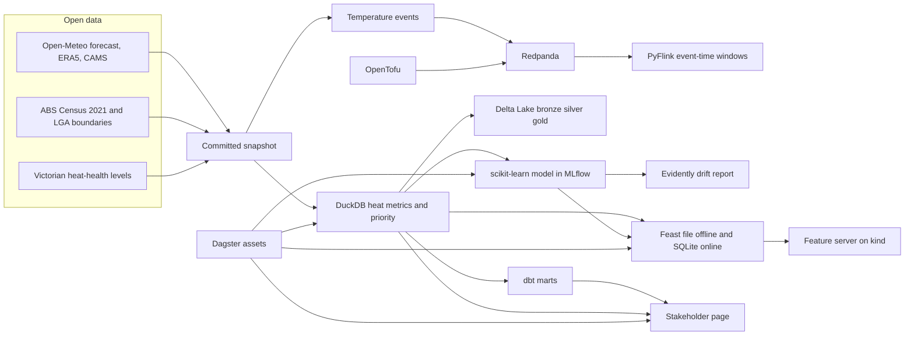

# Victoria heat and health sentinel

[](https://github.com/LuciferDataEngineer/vic-heat-health-sentinel/actions/workflows/ci.yml)
[](https://github.com/LuciferDataEngineer/vic-heat-health-sentinel/actions/workflows/flink.yml)
[](https://github.com/LuciferDataEngineer/vic-heat-health-sentinel/actions/workflows/platform.yml)
[](https://luciferdataengineer.github.io/vic-heat-health-sentinel/)
[](LICENSE)
[](https://www.python.org/)

**Live page:** [https://luciferdataengineer.github.io/vic-heat-health-sentinel/](https://luciferdataengineer.github.io/vic-heat-health-sentinel/)

A free, open-data early-warning page for Victorian councils and health services. It answers a practical question: over the next 7 to 16 days, which local government areas face dangerous heat, who lives there, and is the air unhealthy as well?

The page is written for people who run cooling centres, outreach and emergency-department rosters. The repository behind it is a small platform: a streaming window over the same temperature events, a lake, a feature store, a checked model, and a Kubernetes smoke test.

This snapshot was accessed at **9:24 am, Saturday 31 October 2026 (Melbourne time)**. No area is forecast to reach 35°C in the next 16 days. **0 people aged 65 and over** sit in a forecast dangerous-heat day. The hottest reading is **31.2°C in Swan Hill on Monday 2 November** (a usual high that day is 27.7°C). For a typical Victorian the fortnight is **2.2°C cooler than usual**. The preparation list still starts with **Mildura**, where a summer averages **32 days of 35°C** and **11,168 people aged 65 and over** live. The findings and the method are in [INSIGHTS.md](INSIGHTS.md).

## The problem

In late October 2026, The Age and the Sydney Morning Herald reported health experts warning that an El Niño summer could bring a record heat-death toll and that Victorian emergency departments were underprepared (21 October 2026). The 2026 MJA–Lancet Countdown Oceania report put the cost of heat-related mortality at about US$1.49 billion a year. Councils do not need another climate essay. They need a morning answer: is this the week to open cooling centres, and if not, where should the lists be ready before December?

## Architecture



Dagster is the entry graph. DuckDB is the warehouse. Flink computes the same three-day mean as a streaming job so the two can be compared. The page does not mention any of these tools.

## Tech stack, and why

| Piece | Choice | Why |
| --- | --- | --- |
| Warehouse | DuckDB | The default engine for this series. Eighty areas and ten years of daily weather are a single-node problem. |
| Streaming | Apache Flink 2.2, PyFlink Table API | Event-time range windows and watermarks over temperature events. Project 3 stopped at Spark Structured Streaming. |
| Broker | Redpanda | Same event payload the Flink job reads, with a JSON Schema contract and a dead-letter topic. Runs in Docker Compose or OpenTofu. |
| Lake | Delta Lake via delta-rs | Bronze, silver and gold tables without a Spark runtime, so CI can write them. Project 3 used Spark for Delta MERGE. |
| Transforms | dbt-duckdb | Tested marts on top of the priority table: unique areas, scores inside 0–100. |
| Features | Feast 0.49 | Offline parquet, online SQLite. No Redis server and nothing paid. Area priority, headcount and the one-day heat probability. |
| Model | scikit-learn `HistGradientBoostingClassifier` | A small, honest one-day-ahead classifier. Tracked in a local MLflow file store. |
| Drift | Evidently 0.4 | Data drift between training summers and later summers. |
| Orchestration | Dagster | Assets are the snapshot, marts, lake, model, drift report, online features and the page, with asset checks. Project 3 already used Airflow datasets. This graph is products, not tasks. |
| Page | Static HTML and Leaflet with OpenStreetMap tiles | GitHub Pages. No server, no token, and no WebGL requirement. |
| Local infra | Docker Compose and OpenTofu docker provider | The broker, described twice on purpose: compose to run, OpenTofu to validate as code. |
| Kubernetes | kind, in its own GitHub Actions job | Deploys the feature server and curls it. The fast CI job does not wait for a cluster. |
| Quality | pytest, dbt tests, manifest checksums | The committed snapshot is hashed. A rebuilt headline has to match the mart. |

Postgres is not used. Nothing here needs row-level transactions. Supabase, Snowflake, Databricks and the hyperscalers are out of scope: this project stays on free data and free tools.

## What's new versus fuel-shock-radar

Project 3 was an OLTP-to-lake path: Postgres, Debezium, Redpanda, PySpark Structured Streaming, Delta MERGE and SCD2, Airflow datasets, OpenLineage, Great Expectations. That stack answers "how does a changing operational table land in a lake?"

This project answers a different question, and the stack moves with it.

- **Event time, not change data capture.** Temperature arrives as dated events. PyFlink puts watermarks on them and computes a three-day mean. There is no database log to tail.
- **A feature store and a checked model.** Feast serves area features. A gradient-boosting model is trained on earlier summers, scored on later summers, and compared with two baselines. MLflow keeps the run. Evidently compares the two eras. Project 3 had no model.
- **A lake without Spark.** delta-rs writes Delta tables. DuckDB still serves the marts. CI does not need a JVM cluster for the warehouse path.
- **Platform smoke test.** A kind cluster runs the feature server from the same rows Feast materialises. OpenTofu describes the local broker.
- **A benchmark with a result, not a slogan.** On the full snapshot, DuckDB is about 200 times faster than Flink. The write-up says so.

Redpanda remains, because the events still need a log. Airflow, Debezium, Spark and Great Expectations do not: they solved the previous problem.

## Data sources

All of these are free. No API key. EPA Victoria's keyed API is not used. Each file in `data/snapshot/` is listed in `data/manifest.json` with a row count and a SHA-256. Accessed **31 October 2026**.

| Dataset | Publisher | URL | Licence | Coverage |
| --- | --- | --- | --- | --- |
| Forecast API | Open-Meteo | https://api.open-meteo.com/v1/forecast | CC BY 4.0 | 16 daily temperatures at one interior point per Victorian LGA, 31 Oct–14 Nov 2026 |
| Historical weather API (ERA5) | Open-Meteo and Copernicus | https://archive-api.open-meteo.com/v1/archive | CC BY 4.0 | Daily temperature, 1 Jan 2016–30 Oct 2026, same points. The archive lags the present; 30 Oct was the last day it returned |
| Air-quality API (CAMS) | Open-Meteo and Copernicus | https://air-quality-api.open-meteo.com/v1/air-quality | CC BY 4.0 | Hourly fine particles and ozone, next 5 days, rolled up to local days. Smoke is not a separate field; fine particles are the proxy |
| LGA boundaries, ASGS 2021 | Australian Bureau of Statistics | https://geo.abs.gov.au/arcgis/rest/services/ASGS2021/LGA/MapServer | CC BY 4.0 | 80 Victorian polygons with a geometry. Simplified for the map |
| Census 2021, G01 | ABS | Census G01 feature service | CC BY 4.0 | Usual residents, children 0–4, ages 65–74, 75–84, 85+ |
| Income, 2021 | ABS Data by Region | Income feature service | CC BY 4.0 | Median equivalised household income and the share under $500 a week |
| Households, 2021 | ABS Data by Region | Family and community feature service | CC BY 4.0 | Lone-person households and total households |
| Heat-health levels | Victorian Department of Health | https://www.health.vic.gov.au/environmental-health/heat-health-warning | Public page, cited | District levels 30, 32 and 34°C and the council list |

"No usual address" and "Migratory – Offshore – Shipping" have no polygon and are dropped. Census cells include the ABS's small random adjustments.

## Cleaning and transformation

1. Keep local government areas that have a polygon. Sample the interior point of the largest part, so a coastal council is not sampled in the bay.
2. Attach the published district and temperature level. Yarriambiack, which straddles the Mallee fence, gets the lower Wimmera level. One unincorporated area falls back to the Central level and is flagged.
3. Union the archive and the forecast. If a day is in both, the archive wins.
4. A **dangerous heat day** on the page is a maximum of 35°C or more.
5. A **health-alert day** averages today's maximum with the next night's minimum and compares it with the district level. The last forecast day has no following night, so it is not flagged.
6. The excess heat factor follows the Bureau's definition: the three-day mean temperature against the 95th percentile of daily means in 2016–2025, times how much hotter those three days are than the 30 days before them. Severe is the 85th percentile of positive values; extreme is three times that. The recent baseline is deliberate. A 1971–2000 baseline would call ordinary recent hot days exceptional.
7. A typical summer is November to March, and only seasons with at least 140 days, from 2016–17 through 2025–26.
8. "Usual" for a calendar date is the average maximum on that month and day across 2016–2025.
9. Fine particles are unhealthy when the daily mean is at least 25 µg/m³. Ozone is unhealthy when the maximum 8-hour mean is at least 130 µg/m³.
10. The priority index is documented in [INSIGHTS.md](INSIGHTS.md). It is not the model score.

## Data model

| Layer | Table | Grain |
| --- | --- | --- |
| Snapshot | `history_daily`, `forecast_daily`, `air_quality_daily`, `census_lga` | Source rows as downloaded |
| Delta bronze | the same three weather tables | Unmodified parquet, written as Delta |
| Delta silver / `lga_daily` | one row per area per day | Temperatures, health-alert flag, 35°C flag, excess heat factor, heatwave category |
| Delta gold / `lga_priority` | one row per area with at least 100 residents | Priority, headcounts, summer rates, forecast summary |
| dbt `stg_lga_priority` | the gold table, tested | Unique area code, score in 0–100 |
| dbt `mart_top10_priority` | ten rows | The preparation list |
| Feast `area_heat` | one online row per area | Priority, older residents, days ahead, one-day probability |

## Model, validation and drift

Target: will today's maximum reach 35°C, using only information from earlier days?

Split: train on summers from November 2016 to March 2022, test on summers from November 2022 to March 2026. About 5.2% of summer area-days are positive in both eras (79,280 train rows, 48,400 test rows).

| Estimate | ROC AUC | Average precision | Brier (lower is better) |
| --- | ---: | ---: | ---: |
| HistGradientBoosting | 0.88 | 0.30 | 0.042 |
| Persistence (yesterday was 35°C) | 0.63 | 0.12 | 0.074 |
| Area-month rate from the training summers | 0.72 | 0.14 | 0.048 |

The strongest input is yesterday's maximum, then the area's own climate. The model beats both baselines. It is not on the public page: the 16-day forecast is the operational input, and the page says it is not a prediction of illness.

Evidently's data-drift preset, on 12,000 training summer days against 12,000 later summer days and the same 11 inputs, found **no dataset drift and no drifted column**. Reports land in `reports/model_metrics.json`, `reports/drift_summary.json` and `reports/drift_report.html`. The MLflow file store is `reports/mlruns/` (gitignored; rebuild with `make model`).

## Benchmark

Same metric: the trailing three-day mean of daily temperature, 80 areas, **317,680** area-days. Flink uses an event-time range window and a watermark one second behind event time. DuckDB uses the same three-row window in one query. Each engine ran in its own process. Peak memory is that process's VmHWM, so the Flink number includes the JVM.

| Engine | Time | Peak memory |
| --- | ---: | ---: |
| DuckDB | 0.07 s | 248 MB |
| PyFlink 2.2 mini-cluster | 14.2 s | 558 MB |

DuckDB is about **200 times** faster at this size, and uses about half the memory. That is the honest result. Flink's reason to exist here is a continuous log with event time, not a one-off batch of a few hundred thousand rows. The numbers are in `reports/benchmark.json`. CI reruns the comparison on a smaller slice of the same snapshot and fails if the two engines disagree by more than a millionth of a degree.

## Run it

Python 3.11 or 3.12.

```bash
python -m venv .venv
source .venv/bin/activate
pip install -e ".[dev]"

make pipeline    # DuckDB marts and reports/headline.json
make lake        # Delta bronze / silver / gold
make model       # train, baselines, MLflow
make drift       # Evidently report
make features    # Feast apply and materialise
make dbt         # tested marts
make dashboard   # site/index.html
make test        # ruff and pytest
make all         # pipeline through the page
```

Refresh the live forecast (needs the network; the committed snapshot is the fallback):

```bash
python -m vhhs.ingest --forecast-only
make pipeline dashboard
```

A full history download, which is what produced `data/snapshot/`, is `make snapshot`. It calls Open-Meteo once per area and the ABS services once.

Broker:

```bash
docker compose -f infra/docker-compose.yml up -d
python -m vhhs.redpanda_io --produce --limit 500
python -m vhhs.redpanda_io --consume --limit 5
```

The same broker as code, if you would rather apply OpenTofu than compose. Do not run both: they both bind port 9092.

```bash
cd infra/tofu
tofu init
tofu apply
```

Flink, including the Kafka connector jar if you want the job to read Redpanda instead of the in-memory snapshot:

```bash
pip install -e ".[flink]"
export JAVA_HOME=$(dirname $(dirname $(readlink -f $(which java))))
make flink
make bench
# optional: download flink-sql-connector-kafka-5.0.0-2.2.jar and
# VHHS_FLINK_KAFKA_JAR=... python -m vhhs.flink_job --kafka localhost:9092 --lga-limit 2
```

Feature server on a local kind cluster:

```bash
python -m vhhs.pipeline
cp data/serving/area_features.json services/feature_server/area_features.json
docker build -t vhhs-feature-server:local services/feature_server
kind create cluster --name vhhs
kind load docker-image vhhs-feature-server:local --name vhhs
kubectl apply -f infra/k8s/feature-server.yaml
kubectl port-forward svc/feature-server 8080:80
curl localhost:8080/health
```

Dagster, if you want the asset graph instead of the Make targets:

```bash
dagster asset materialize -m vhhs.definitions
```

## Testing and CI

- `pytest` checks the excess-heat formula against a hand calculation, the district table, the JSON Schema contract, the manifest checksums, the January 2019 Mildura heatwave, and that the public page does not name the tools.
- `ruff check src tests` is the lint.
- dbt tests uniqueness, nulls, and the 0–100 score range.
- **CI** installs the project and runs the warehouse, the lake, the model, drift, Feast, dbt, the page and pytest. A second job runs `tofu init` and `tofu validate`.
- **Flink** is its own workflow, on Java 21, and compares a slice of the snapshot with DuckDB.
- **Platform** builds the feature-server image, loads it into kind, and curls `/health` and `/features`.
- **Pages** deploys `site/` on every push to `main`.
- **Refresh forecast** runs at 07:30 Melbourne time during daylight saving (`30 20 * * *` UTC), downloads a new forecast, and commits the snapshot. The push redeploys the page. History and the Census stay as they are.

## Limitations

- Not a medical forecast. It does not estimate deaths, ambulance calls or hospital presentations.
- One point per area. Towns inside a large shire can be hotter or cooler than the sample point. A true centroid can fall in the bay, so the point is the interior of the largest polygon instead.
- Census figures are from 2021. Population has moved since then.
- ERA5 is a reanalysis, not a Bureau station. The forecast is a model, not a warning issued by the Bureau.
- CAMS is a global air-quality model. It is not the EPA Victoria monitor network, and it has no separate smoke product.
- The health-alert levels are the Department's published thresholds. They are strict, because they need a warm night. Days of 35°C are much more common and are what the page calls dangerous heat.
- The excess-heat baseline is 2016–2025, not the Bureau's older climate normal.
- Flink runs as a local mini-cluster, including in CI. kind runs the feature server, not a Flink session cluster.
- The one-day model is a check on recent observations. It is not the number on the map.

## Next steps

- Move from local government areas to SA2 where the Census and a free boundary file line up, so inner-city heat and outer-suburban heat are not averaged together.
- Add public hospital and aged-care locations from DataVic if a stable, key-free file is available, and show them on the map.
- When a hot spell is inside the 16-day window, check that the page status flips to "Prepare now" and that the older-resident count matches the areas over 35°C.
- If this ever needs to run continuously, put the Flink job on the Redpanda topic full time. At today's volume, DuckDB remains the right batch engine.
